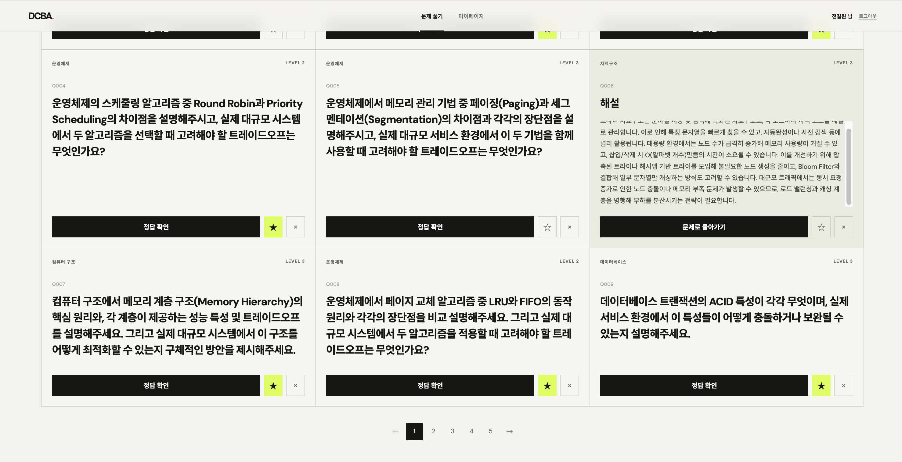
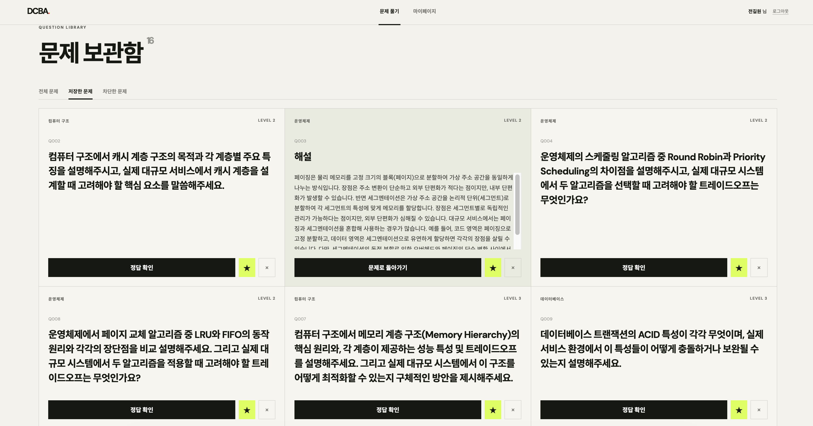

# DCBA
> CS 학습을 위한 LLM CS 문제 생성 서비스
## 목차
1. [기능](#기능)
2. [요약](#요약)
3. [실행 조건](#1-실행-조건)
4. [실행 방법](#2-전체-서비스-실행)
5. [접속 주소](#3-접속-주소)
6. [실행 확인](#4-정상-실행-확인)
7. [주요 명령어](#5-주요-명령)
8. [선택 설정](#6-선택-설정)
9. [서비스 이미지 확인](#서비스-이미지) 


## 기능
1. 문제 자동 생성 (1분)
2. 원하는 문제 생성 요청
3. 문제 중복 생성 방지
4. 문제 저장 및 차단 기능
    - 저장 : 원하는 문제만 따로 모아보기
    - 차단 : 문제 전체 확인 시 안 보이도록 설정
5. 웹을 통해 문제 확인 가능
    - 정답 확인 버튼을 통해 정답 확인 가능

## 요약
| 항목 | 내용 |
|---|---|
| Web | React |
| API | Spring Boot |
| LLM | FastAPI + `kakaocorp/kanana-2-3b-instruct` |
| Data | MariaDB + Redis |
| 실행 | Docker Compose |

## 1. 실행 조건

| 필수 항목 | 기준 |
|---|---|
| Docker | Docker Desktop 또는 Docker Engine + Compose |
| 메모리 | Kanana 실행 시 Docker 메모리 12GB 이상 권장 |
| 디스크 | 최초 모델 다운로드용 여유 공간 7GB 이상 |

## 2. 전체 서비스 실행

```bash
docker compose --profile llm up -d --build
```

| 최초 실행 | 내용 |
|---|---|
| 모델 다운로드 | Kanana 가중치 약 6.5GB 다운로드 |
| 모델 캐시 | `huggingface_cache` Docker 볼륨에 보관 |
| 문제 생성 | CPU 환경에서는 첫 생성에 시간이 오래 걸릴 수 있음 |

## 3. 접속 주소

| 서비스 | 주소 |
|---|---|
| Web | http://localhost |
| Spring API | http://localhost:8080 |
| LLM API 문서 | 내부 네트워크 `http://llm-server:8000/docs` |
| LLM 상태 확인 | 내부 네트워크 `http://llm-server:8000/health` |

## 4. 정상 실행 확인

```bash
docker compose --profile llm ps
docker logs -f llm-server
```

| 로그 | 상태 |
|---|---|
| `[Kanana] Model loaded: kakaocorp/kanana-2-3b-instruct` | 모델 준비 완료 |
| `[Consumer] Processing: ...` | 문제 생성 중 |
| `[Consumer] Saved : ... (ID : ...)` | DB 저장 완료 |

## 5. 주요 명령

| 작업 | 명령 |
|---|---|
| 기본 서비스만 실행 | `docker compose up -d --build` |
| LLM 포함 실행 | `docker compose --profile llm up -d --build` |
| 모니터링 포함 실행 | `docker compose --profile llm --profile monitoring up -d --build` |
| 전체 상태 확인 | `docker compose --profile llm ps` |
| LLM 로그 확인 | `docker logs -f llm-server` |
| 생성 대기 작업 수 확인 | `docker exec redis-cache redis-cli LLEN exercise:generation_queue` |
| 전체 중지 | `docker compose down` |

## 6. 선택 설정

| 조건 | 설정 |
|---|---|
| 기본값으로 실행 | `.env` 파일 불필요 |
| 포트·모델·중복검사 변경 | `.env.example`을 `.env`로 복사 후 수정 |

```bash
cp .env.example .env
```

| 변수 | 기본값 | 용도 |
|---|---|---|
| `KANANA_MODEL_NAME` | `kakaocorp/kanana-2-3b-instruct` | 생성 모델 |
| `DEDUPLICATION_ENABLED` | `false` | 중복 검사 활성화 여부 |
| `OPENAI_API_KEY` | 없음 | 중복 검사 활성화 시 필요 |
| `FRONTEND_PORT` | `80` | Web 외부 포트 |
| `DCBA_SERVER_PORT` | `8080` | Spring API 외부 포트 |
| `LLM_API_KEY` | 비어 있음 | 내부 직접 생성 API 인증 키, 미설정 시 해당 API 비활성화 |

## 서비스 이미지




### 안정성 개선 통합 시 배포

React·REST API·Slack·Kanana 및 선택적 중복 검사는 유지됩니다. 문제 목록은 전체 건수와 번호 페이지 대신 이전·다음 이동을 사용합니다. 배포 전에 기존 MariaDB와 Redis 데이터를 백업하세요. 공통 스키마 마이그레이션이 성공한 뒤 Java와 LLM 서버가 시작되며 Java 운영 설정은 스키마를 검증만 합니다. 중복 저장 기록, 고아 참조, 필수 값 누락이 발견되면 데이터를 삭제하지 않고 마이그레이션을 중단하므로 운영자가 기존 자료를 확인해야 합니다. Slack 정보는 유지됩니다.

Redis는 내부 네트워크에서만 접근하며 AOF를 매 쓰기마다 동기화합니다. 디스크 지연이 큐 처리 지연에 반영됩니다. MariaDB와 Prometheus 관리 포트는 로컬에만 열고 Java 지표는 내부 9091 포트로 분리합니다. LLM의 직접 생성 API는 내부 접근과 별도 `LLM_API_KEY`가 필요하며 키가 없으면 비활성화됩니다. React의 로그인 사용자 생성 요청은 기존 Java 큐 API로 계속 동작합니다. 임베딩 중복 검사를 사용할 때만 `DEDUPLICATION_ENABLED=true`와 유효한 OpenAI 키가 필요합니다. 모델 캐시와 중복 검사 인덱스는 각각 영구 볼륨에 보관합니다.

LLM의 `/health`는 프로세스 생존, `/ready`는 실제 생성 성공·큐·DB 상태를 확인합니다. Kanana 최초 다운로드와 CPU 추론 중에는 첫 생성이 완료될 때까지 준비되지 않은 상태가 정상입니다. 마지막 성공이 1시간보다 오래되면 준비 상태를 해제하므로 실제 장비의 추론 시간을 고려해 운영하세요. 준비 상태는 프로세스 재시작 조건으로 사용하지 않습니다. 실패 작업은 Redis의 `exercise:generation_failed`에 원문과 함께 남고 자동 삭제되지 않습니다. 원인 수정 후 확인하여 재등록하고, 보관량과 디스크를 관리해야 합니다.

기존 목록 큐의 작업은 원자적으로 Stream으로 이전합니다. DB 저장과 작업 완료 기록은 같은 트랜잭션으로 반영되어 재처리 시 중복 저장을 방지합니다. 중복 검사 인덱스는 DB의 확정된 문제를 기준으로 복구합니다. 로컬 벡터 저장소는 단일 생성 서버를 전제로 하며 여러 생성 서버를 운영하려면 공용 벡터 서버가 필요합니다. 인증 요청 제한은 프록시가 전달한 임의 주소를 신뢰하지 않으므로 기본 nginx 배포에서는 같은 프록시를 경유한 요청이 제한 예산을 공유합니다. 사용자별 제한이 필요하면 신뢰할 수 있는 진입점에서 적용해야 합니다.


CI는 Java·Python·React 검증을 유지하며 문서만 바뀐 경우 기존 경로 제외 규칙을 유지합니다. Java는 테스트 실행을 생략하지 않고 컴파일 캐시를 사용하며 검증한 JAR을 배포 이미지에 그대로 넣습니다. Python은 운영·테스트 의존성을 나누고 uv 캐시를 사용하되 CPU용 추론 패키지와 Kanana 지원은 유지합니다. 배포는 lint와 테스트 성공 후 main push에서만 실행되며 main의 진행 중 배포는 새 커밋 때문에 취소하지 않습니다. 검토용 누적 PR에서도 최종 CI 변경을 검증할 수 있게 `review/**` 기준 브랜치를 허용합니다. GitHub 실행 시간·원격 캐시 적중률과 이미지 배포 결과는 실제 실행 기록으로 확인해야 합니다.
