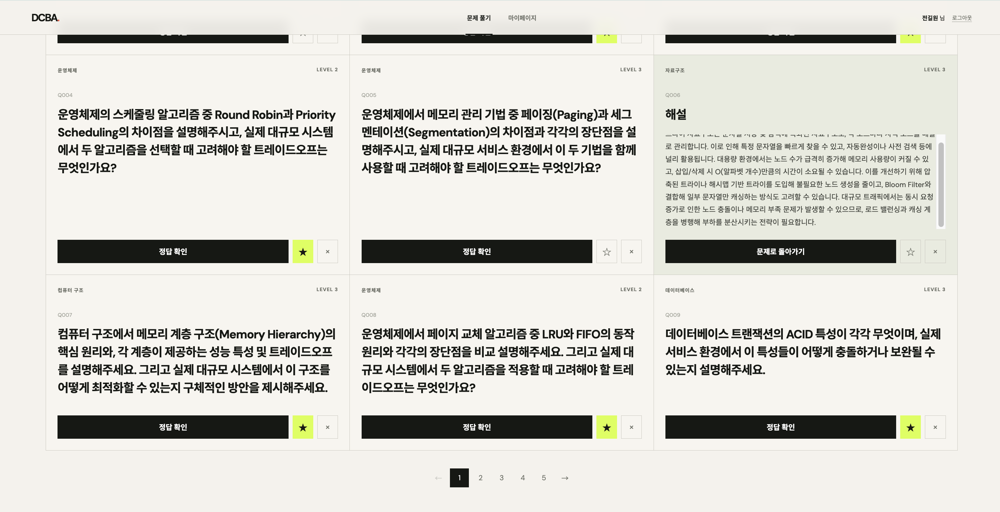
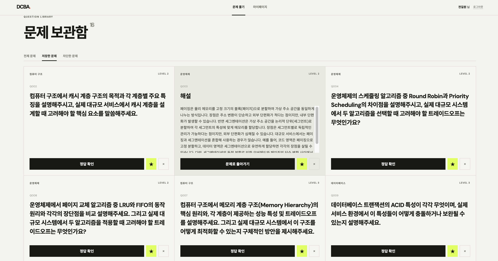

# DCBA
> CS 학습을 위한 LLM CS 문제 생성 서비스
## 목차
1. [기능](#기능)
2. [요약](#요약)
3. [실행 조건](#1-실행-조건)
4. [실행 방법](#2-전체-서비스-실행)
5. [접속 주소](#3-접속-주소)
6. [실행 확인](#4-정상-실행-확인)
7. [주요 명령어](#5-주요-명령)
8. [선택 설정](#6-선택-설정)
9. [서비스 이미지 확인](#서비스-이미지) 


## 기능
1. 문제 자동 생성 (1분)
2. 원하는 문제 생성 요청
3. 문제 중복 생성 방지
4. 문제 저장 및 차단 기능
    - 저장 : 원하는 문제만 따로 모아보기
    - 차단 : 문제 전체 확인 시 안 보이도록 설정
5. 웹을 통해 문제 확인 가능
    - 정답 확인 버튼을 통해 정답 확인 가능

## 요약
| 항목 | 내용 |
|---|---|
| Web | React |
| API | Spring Boot |
| LLM | FastAPI + NVIDIA NIM Chat Completions API |
| Data | MariaDB + Redis |
| 실행 | Docker Compose |

## 1. 실행 조건

| 필수 항목 | 기준 |
|---|---|
| Docker | Docker Desktop 또는 Docker Engine + Compose |
| 문제 생성 | NVIDIA API 키와 채팅 모델 ID, OpenAI 임베딩 API 키, Chroma 저장소, HTTPS 연결 |

## 2. 전체 서비스 실행

처음 실행할 때 `.env.example`을 `.env`로 복사하고 `NVIDIA_API_KEY`와 `NVIDIA_MODEL`을 입력합니다. 기존 `.env`가 있다면 해당 항목만 추가합니다. `NVIDIA_BASE_URL` 기본값은 NVIDIA 개발용 엔드포인트입니다. 운영에서는 사용 계약과 요청 한도가 확인된 엔드포인트를 설정하세요. API 키는 `.env` 또는 서버의 비밀 저장소에서 워커에 주입합니다. [NVIDIA API 시작 가이드](https://docs.api.nvidia.com/nim/re/docs/api-quickstart) · [NVIDIA API 체험 약관](https://assets.ngc.nvidia.com/products/api-catalog/legal/NVIDIA%20API%20Trial%20Terms%20of%20Service.pdf)

```bash
docker compose -p dcba --profile llm up -d --build
```

기존 배포를 업데이트할 때는 기존 Compose 프로젝트 이름과 데이터 볼륨을 사용합니다. 자동 생성의 기본 간격은 60초입니다. 사용자 요청이나 처리 중인 작업이 있으면 그 회차의 자동 생성을 건너뜁니다.

## 3. 접속 주소

| 서비스 | 주소 |
|---|---|
| Web | http://localhost |
| Spring API | http://localhost:8080 |
| LLM API 문서 | 내부 네트워크 `http://llm-server:8000/docs` |
| LLM 상태 확인 | 내부 네트워크 `http://llm-server:8000/health` |

## 4. 정상 실행 확인

```bash
docker compose -p dcba --profile llm ps
docker compose -p dcba --profile llm logs -f llm-server
```

| 로그 | 상태 |
|---|---|
| `[Consumer] Processing: ...` | 문제 생성 중 |
| `[Consumer] Saved exercise ...` | DB 저장 완료 |

## 5. 주요 명령

| 작업 | 명령 |
|---|---|
| 기본 서비스만 실행 | `docker compose -p dcba up -d --build` |
| LLM 포함 실행 | `docker compose -p dcba --profile llm up -d --build` |
| 모니터링 포함 실행 | `docker compose -p dcba --profile llm --profile monitoring up -d --build` |
| 전체 상태 확인 | `docker compose -p dcba --profile llm ps` |
| LLM 로그 확인 | `docker compose -p dcba --profile llm logs -f llm-server` |
| 생성 대기 및 처리 중 작업 수 확인 | `docker compose -p dcba exec redis redis-cli XLEN exercise:generation_stream` |
| 전체 중지 | `docker compose -p dcba --profile llm --profile monitoring down` |

## 6. 선택 설정

| 조건 | 설정 |
|---|---|
| 기본값으로 실행 | `.env` 파일 불필요 |
| 포트·모델·중복검사 변경 | `.env.example`을 `.env`로 복사 후 수정 |

```bash
cp .env.example .env
```

| 변수 | 기본값 | 용도 |
|---|---|---|
| `NVIDIA_API_KEY` | 없음 | 생성 API 인증 키 |
| `NVIDIA_MODEL` | 없음 | 엔드포인트에서 사용 가능한 모델 ID |
| `NVIDIA_BASE_URL` | `https://integrate.api.nvidia.com/v1` | Chat Completions API의 HTTPS 기본 주소 |
| `DEDUPLICATION_ENABLED` | Compose에서 `true` | 큐 출제와 추천에 필요한 중복 검색 활성화 |
| `OPENAI_API_KEY` | 없음 | 중복 검사 활성화 시 필요 |
| `FRONTEND_PORT` | `80` | Web 외부 포트 |
| `DCBA_SERVER_PORT` | `8080` | Spring API 외부 포트 |
| `LLM_API_KEY` | 비어 있음 | 내부 직접 생성 API 인증 키, 미설정 시 해당 API 비활성화 |

## 서비스 이미지




### 안정성 개선 통합 시 배포

문제 목록은 전체 건수와 번호 페이지 대신 이전·다음 이동을 사용합니다. 배포 전에 기존 MariaDB와 Redis 데이터를 백업하세요. 공통 스키마 마이그레이션이 성공한 뒤 Java와 LLM 서버가 시작되며 Java 운영 설정은 스키마를 검증만 합니다. 중복 저장 기록, 고아 참조, 필수 값 누락이 발견되면 데이터를 삭제하지 않고 마이그레이션을 중단하므로 운영자가 기존 자료를 확인해야 합니다. Slack 정보는 유지됩니다.

Redis는 내부 네트워크에서만 접근하며 AOF를 매 쓰기마다 동기화합니다. 디스크 지연이 큐 처리 지연에 반영됩니다. MariaDB와 Prometheus 관리 포트는 로컬에만 열고 Java 지표는 내부 9091 포트로 분리합니다. LLM의 직접 생성 API는 내부 접근과 별도 `LLM_API_KEY`가 필요하며 키가 없으면 비활성화됩니다. React의 로그인 사용자 생성 요청은 기존 Java 큐 API로 계속 동작합니다. 큐 출제와 추천은 `DEDUPLICATION_ENABLED=true`와 유효한 OpenAI 키가 필요하며, 검색 실패 시 문항 저장을 중단합니다. 중복 검사 인덱스는 기존 Chroma 볼륨에 보관합니다.

학습 의도에는 공개 가능한 CS 개념과 학습 목표만 입력하세요. 생성 전후 검사에서는 이메일, 휴대전화 번호, 표준 식별자, 알려진 계정 형식과 일부 반복 구절을 차단합니다. 일반 이름, 임의의 사내 표현, 변형된 문장이 모두 감지된다는 보장은 없으므로 공개할 수 없는 정보는 입력에서 빼야 합니다. 진행 중인 요청은 계속 조회할 수 있고, 최근 실패는 7일간 표시됩니다. 완료 알림은 MariaDB에서 별도로 조회합니다.

LLM의 `/health`는 프로세스 생존, `/ready`는 실제 생성 성공·큐·DB 상태를 확인합니다. 처음 생성이 성공하기 전과 마지막 성공 후 1시간이 지나면 준비 상태가 해제됩니다. 준비 상태는 프로세스 재시작 조건으로 사용하지 않습니다. NVIDIA API의 일시적 오류는 Redis 큐에서 재처리합니다. 재시도 한도를 넘기거나 인증·모델 설정 오류가 발생한 작업은 `exercise:generation_failed`에 남습니다. 원인을 수정한 뒤 실패 작업을 검토해 재등록하세요.

기존 목록 큐의 작업은 원자적으로 Stream으로 이전합니다. DB 저장과 작업 완료 기록은 같은 트랜잭션으로 반영되어 재처리 시 중복 저장을 방지합니다. 중복 검사 인덱스는 DB의 확정된 문제를 기준으로 복구합니다. 로컬 벡터 저장소는 단일 생성 서버를 전제로 하며 여러 생성 서버를 운영하려면 공용 벡터 서버가 필요합니다. 인증 요청 제한은 프록시가 전달한 임의 주소를 신뢰하지 않으므로 기본 nginx 배포에서는 같은 프록시를 경유한 요청이 제한 예산을 공유합니다. 사용자별 제한이 필요하면 신뢰할 수 있는 진입점에서 적용해야 합니다.


CI는 Java·Python·React를 검증하며 문서 변경에는 경로 제외 규칙을 적용합니다. Java는 컴파일 캐시를 사용하며 검증한 JAR을 배포 이미지에 그대로 넣습니다. Python은 운영·테스트 의존성을 나누고 uv 캐시를 사용하며, 테스트에서는 NVIDIA 응답을 모의합니다. 배포 이미지는 `main` 커밋의 lint와 테스트가 성공한 뒤 발행합니다. 검토용 누적 PR에서도 CI를 실행할 수 있도록 `review/**` 기준 브랜치를 허용합니다.

### EC2 시험 환경 자동 배포

기능 브랜치의 PR에서 테스트를 통과해 `main`에 들어간 커밋은 GitHub Actions가 AMD64·ARM64 이미지를 빌드하고, 커밋 SHA에 맞는 애플리케이션·마이그레이션 이미지를 EC2에 배포합니다. 필요하면 Actions의 **DCBA EC2 Release**에서 `main`을 선택해 수동 실행할 수 있습니다.

웹 API가 응답하면 EC2 배포 스크립트가 `search-index` 작업을 백그라운드에서 시작합니다. 작업이 끝날 때까지 검색은 기존 본문 조건으로 동작하며, 완료되면 앱을 재시작하지 않아도 인덱스 검색이 활성화됩니다. 같은 Compose 설정에서 `docker compose ps -a search-index`와 `docker compose logs search-index`로 작업 상태를 확인할 수 있습니다. 실패하면 원인을 확인한 뒤 `docker compose up -d --force-recreate search-index`로 다시 실행할 수 있습니다.

EC2에는 SSM Agent와 역할, Git, curl, Docker Engine과 Compose 2.24.4 이상이 필요합니다. `/opt/dcba/.env`를 서버에 만들고 파일 권한을 `0600`으로 설정합니다. `MARIADB_PASSWORD`와 `MARIADB_ROOT_PASSWORD`에는 서로 다른 임의 값을 사용합니다. 문제 생성을 쓸 때는 `COMPOSE_PROFILES=llm`과 NVIDIA 환경 변수도 서버에 설정합니다. EC2에서 정기 생성을 사용하려면 `AUTO_GENERATION_ENABLED=true`와 생성 간격(초)인 `AUTO_GENERATION_INTERVAL_SECONDS`를 설정합니다. 워커의 내부 `/ready`에서 적용된 값을 확인할 수 있습니다.

관리자로 지정할 기존 계정의 숫자 ID를 `DCBA_ADMIN_USER_ID`에 설정하면 해당 계정에 관리자 메뉴가 표시됩니다. 관리자 화면에서 자동 생성을 중단하면 Redis에 상태가 저장되므로 워커를 재시작해도 중단 상태가 유지됩니다. 수동 생성과 이미 큐에 들어간 작업은 계속 처리됩니다. 워커의 내부 `/ready`에서 환경 설정은 `auto_generation_enabled`, 관리자 중단 여부는 `auto_generation_paused`로 확인합니다.

관리자 화면의 문제 풀에서 개별 문제를 삭제할 수 있습니다. 삭제한 문제는 모든 사용자의 저장·차단 목록에서도 제거됩니다. 중복 검사 인덱스는 중복 검사가 활성화된 워커가 다음에 생성 작업을 처리할 때 정리됩니다.

GitHub 저장소 Variables의 `DCBA_EC2_INSTANCE_ID`와 `DCBA_EC2_ROLE_ARN`에 시험 서버와 배포 역할을 지정합니다. AWS 배포 역할은 이 저장소의 `main`만 OIDC로 신뢰하고, 해당 인스턴스와 `AWS-RunShellScript` 문서에 `ssm:SendCommand`를 허용합니다. 결과 확인에는 `ssm:GetCommandInvocation`이 필요합니다. 웹은 EC2 내부 `127.0.0.1:8080`에 열리며, 보안 그룹 변경 없이 Session Manager 포트 포워딩으로 확인할 수 있습니다.

### 저장한 문제 복습과 AI 피드백

대시보드의 **저장한 문제** 탭에서 현재 분야·난이도로 최대 세 문제를 연습할 수 있습니다. **다시 풀기** 표시는 저장 관계에 유지됩니다. 연습 회차와 입력한 답은 브라우저에서만 관리하며, AI 피드백을 요청한 경우 답변을 평가 모델로 전달합니다.

AI 피드백은 기본으로 꺼져 있습니다. 활성화하려면 서버의 `REVIEW_FEEDBACK_ENABLED=true`와 공유 내부 키 `LLM_API_KEY`를 Java와 LLM 컨테이너에 적용하고, 기존 NVIDIA 생성 설정이 있는 LLM 워커를 실행해야 합니다. `REVIEW_LLM_BASE_URL` 기본값은 `http://llm-server:8000`입니다. 랜덤 복습과 다시 풀기 표시는 LLM 워커 없이도 사용할 수 있습니다.

운영 문제의 기준은 실제 질문·해설을 검수하고 확인한 문제 ID에만 등록합니다. 마이그레이션은 개발 표본을 운영 DB에 삽입하지 않습니다. 개발 기준 9문제와 표본 답변의 기대 판정은 `LLM-Server/tests/fixtures/review_feedback.json`에 있습니다. AI를 켜기 전 검수자가 표본의 기대 판정을 확인한 뒤 다음 검수를 실행해 기준별 일치율 85% 이상과 핵심 오류 오판 부재를 확인합니다.

```bash
cd LLM-Server
RUN_REVIEW_MODEL_VALIDATION=true python -m pytest tests/routers/test_review.py -k live_review
```
